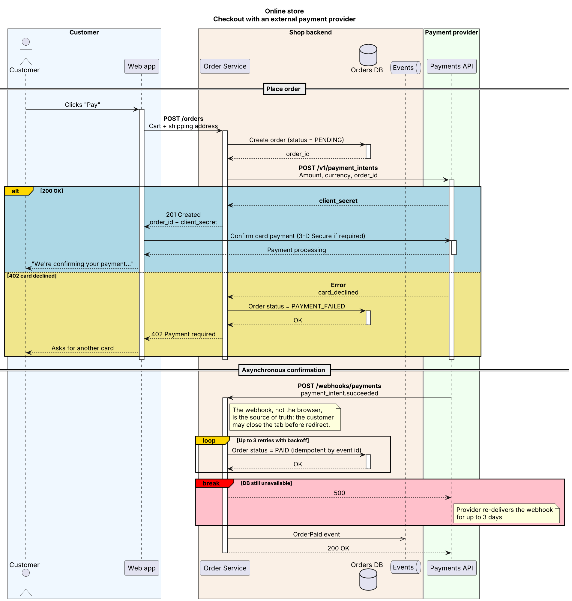
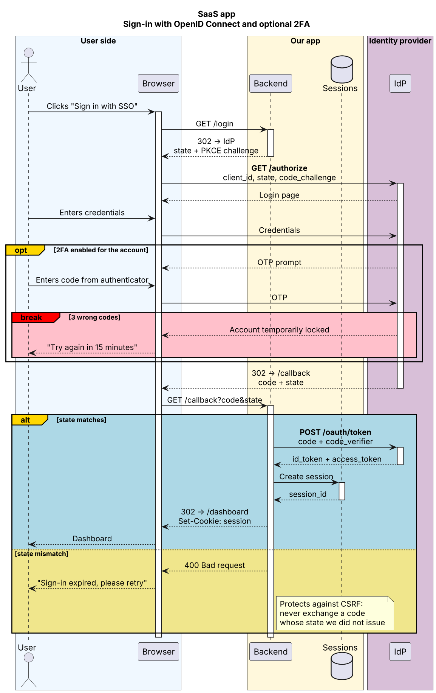
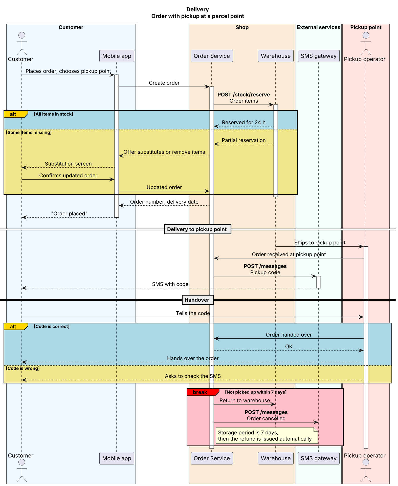

# sequence-diagram — a Claude skill

A [Claude skill](https://docs.claude.com/en/docs/agents-and-tools/agent-skills/overview) that turns a described interaction flow into a readable **PlantUML** sequence diagram:

- participants grouped into colored boxes by system/domain;
- actor / participant / database stereotypes and activation bars;
- semantically colored `alt` / `opt` / `loop` / `break` blocks for branches and errors.

Works from prose, bullet steps, or a rough sketch of who calls whom.

## Examples

Each example is the input flow described in plain words → the `.puml` the skill produces → the rendered diagram. Sources are in [`examples/`](examples/).

### Checkout with an external payment provider

> Customer pays for an order. The order service creates a payment intent at the provider; the card may be declined. Payment is finally confirmed by an asynchronous webhook, which is retried if the database is down.

Shows: four domain boxes, database and queue stereotypes, `==` phase dividers, `alt` success/decline, `loop` retries, red `break` abort path, notes explaining *why*.



<sub>Source: [`01-checkout-payment.puml`](examples/01-checkout-payment.puml)</sub>

### Sign-in with OpenID Connect and optional 2FA

> User signs in via SSO. The identity provider may ask for a one-time code; three wrong codes lock the account. The backend exchanges the code for tokens only if `state` matches.

Shows: `opt` with a nested `break`, PKCE/state handling, CSRF note on the alternative branch.



<sub>Source: [`02-sso-login.puml`](examples/02-sso-login.puml)</sub>

### Order with pickup at a parcel point

> Customer orders with pickup at a parcel point. The warehouse reserves items — if some are missing, the customer is offered substitutes. At the pickup point the customer gets an SMS code; an order not collected within 7 days goes back to the warehouse.

Shows: human actors on both ends, a multi-phase flow, two independent `alt` decisions and an expiry `break`.



<sub>Source: [`03-pickup-order.puml`](examples/03-pickup-order.puml)</sub>

## Visual language

| Element | Meaning |
|---|---|
| Pastel `box` | One system / domain — same color for the same system everywhere |
| Solid `->` / dashed `-->` | Request / response |
| **Bold** first line | Technical identifier (endpoint, method, integration ref) |
| Blue `alt` | Normal / success branch |
| Khaki `else` | Alternative outcome |
| Gold `opt` / `loop` | Optional step / repetition |
| Red `break` | Error that aborts the flow |

## Privacy & security

Your diagrams never leave your machine. The skill has **no calls to online PlantUML renderers** (plantuml.com, Kroki, etc.) and sends no diagram content anywhere.

| Step | Where it runs | Network |
|---|---|---|
| Writing the `.puml` | Claude, following `SKILL.md` | — |
| Linting (`validate_puml.py file.puml`) | Local Python, standard library only | None |
| Rendering (`validate_puml.py file.puml --render`) | Local Java, `plantuml.jar` | One-time download of the jar, then none |

**The only network request** is downloading `plantuml.jar` the first time you render. It contains nothing from your diagram — just a fixed URL:

- the version is **pinned** (PlantUML `1.2024.7`) and fetched from the official [GitHub releases](https://github.com/plantuml/plantuml/releases);
- the file is **verified against a SHA-256 checksum** before it is ever run; a mismatch aborts;
- it is cached in `~/.cache/plantuml/` — after that, rendering works **fully offline**.

**Rendering is sandboxed.** PlantUML runs with `PLANTUML_SECURITY_PROFILE=SANDBOX`, so a diagram cannot make the renderer fetch URLs or read local files (`!include`, `!includeurl`, remote sprites are blocked) — even if you render a `.puml` someone else gave you.

**Air-gapped / corporate setups:** download the jar yourself (or from an internal mirror) and point the script at it — then no request is made at all:

```bash
export PLANTUML_JAR=/path/to/plantuml.jar
```

Linting alone never needs the network or Java.

## Contents

| Path | Purpose |
|---|---|
| `SKILL.md` | Instructions Claude follows |
| `assets/template.puml` | Starting template with the color palette |
| `references/` | PlantUML sequence cheatsheet and palette preview |
| `scripts/validate_puml.py` | Lints a `.puml` without Java (unbalanced blocks and activations); `--render` also renders it to SVG locally — see [Privacy & security](#privacy--security) |
| `examples/` | Sample diagrams: `.puml` source + rendered PNG/SVG |

## Install

**Claude Code** — clone into your skills folder:

```bash
git clone https://github.com/igorkosarev/sequence-diagram-skill ~/.claude/skills/sequence-diagram
```

(or into `.claude/skills/sequence-diagram` inside a project to scope it to that project).

**Claude apps (claude.ai / desktop)** — download the repo as ZIP and upload it in Settings → Capabilities → Skills.

## License

MIT
