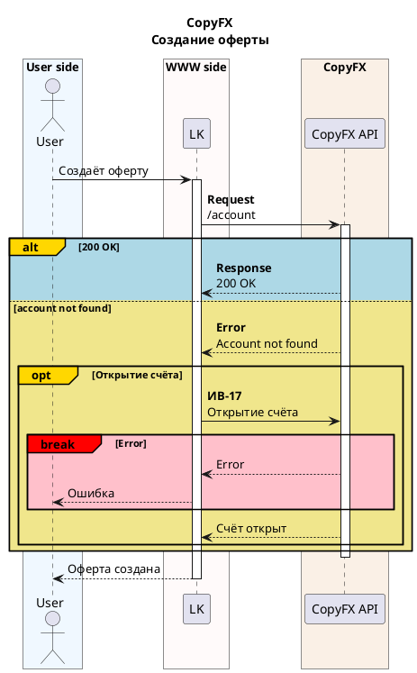

# Sequence Diagram (PlantUML)

Produce sequence diagrams that a reader understands at a glance, from a flow
described in prose, bullet steps, or another notation. Output is **PlantUML**,
not Mermaid — because only PlantUML gives us colored per-domain participant
boxes and colored `alt`/`opt`/`break` blocks, and those two things are what turn
a wall of arrows into something legible.

A great sequence diagram isn't "arrows that are technically correct." It's a
diagram where a reader who wasn't in the room can see, in seconds: **who** is
talking (grouped by system), **what** the normal path is, **where** it branches,
and **what happens when it breaks**. Everything below serves that goal.

## The core idea: visual meaning, not decoration

Color and structure carry information here. Keep them consistent across every
diagram so the reader learns the visual language once:

- **Domain boxes** group participants by the system they live in. Each system
  gets its own light background color. The reader instantly sees "this is our
  side, that's the external provider."
- **Arrows** encode direction of causality: solid `->` for a request/command,
  dashed `-->` for the response/return. Solid-out, dashed-back is what readers
  expect; breaking that convention makes them re-read.
- **Block colors** encode outcome: the normal/success branch is calm (blue),
  alternatives are neutral (khaki), and anything that aborts or errors is red.
  A reader scanning the diagram spots every failure path by its red border.
- **Bold** marks the technical identifier — the endpoint, method, or
  integration reference (`/account`, `ИВ-17`) — the thing you'd grep for. Plain
  text after it explains what the call means to a human.

Message labels stay in the **language the flow was described in** (Russian in,
Russian out). PlantUML keywords (`alt`, `activate`, `note`) are syntax and stay
in English.

## Workflow

Work in this order. Trying to write the whole diagram top-to-bottom in one pass
is how you get tangled activation bars and unbalanced blocks.

### 1. Extract the flow

From the source (prose / bullets / other notation), pull out:
- **Participants**: every actor, service, database, queue, external system.
- **The system each belongs to** — this drives the box grouping. If it's not
  stated, infer from context (our services vs. a third-party API vs. the user).
- **The ordered steps**: who initiates, who calls whom, in what order.
- **Requests vs. responses**: which messages are calls, which are returns.
- **Control flow**: conditionals ("if X then… else…"), optional steps ("if
  present…"), retries/iteration, and failure/abort paths.

If the source is ambiguous about a branch or an error path, note the assumption
inline in the diagram (as a `note`) rather than silently inventing behavior — a
wrong invented branch is worse than a visible question.

### 2. Declare and group participants

Declare every participant up front, inside colored `box` groups ordered
left-to-right by the flow (initiator on the left). Pick the right stereotype:

- `actor` — a human or external caller
- `participant` — a service / application / component (the default)
- `database` — a datastore
- `queue` / `collections` — a message broker / topic (RabbitMQ, Kafka)
- `boundary` / `control` / `entity` — only if the source uses DDD framing

Give each a short alias and use it everywhere: `participant "CopyFX API" as api`.

Assign each box a **pastel** background color from the curated palette in
`references/plantuml-sequence-cheatsheet.md` §3 (a rendered swatch sheet is at
`references/palette.png`). Use soft, non-garish tones — the palette is grouped by
suggested role (cool blues for client/gateway, warm creams for your own services,
greens for external systems, etc.). Pick neighboring boxes from different hue
families so adjacent systems are easy to tell apart, and reuse the same color for
the same system every time it appears — that consistency is what lets a reader
learn your visual map. Reserve strong, saturated color for the *block* semantics
(§6), where red genuinely means "error".

### 3. Lay down the happy path

Write the main success flow first, with activation bars: `activate X` when X
starts working, `deactivate X` when it's done. Balanced activations are what
make nested calls readable — every `activate` needs its `deactivate`.

Use `->` for calls and `-->` for returns. Format each message as
`**<endpoint / ref>**\n<human description>` when there's a technical identifier,
or just the description when there isn't. Self-processing is a self-arrow:
`lk -> lk: Создание новой оферты`.

### 4. Layer in branching and failure

Now wrap the conditional logic. Choose the block that matches the intent — don't
force everything into `alt`:

- `alt` / `else` — mutually exclusive outcomes ("200 OK" vs "not found")
- `opt` — a step that only sometimes happens ("if account missing, create it")
- `loop` — repetition / retry
- `par` — things happening in parallel
- `break` — a path that **aborts** the flow (an error that stops everything)
- `group` — a plain labeled grouping with no conditional meaning

Apply the semantic colors (full list in the cheatsheet):
- normal/primary branch: `alt#Gold #LightBlue`
- alternative branch: `else #Khaki`
- optional: `opt#Gold`
- **error / abort: `break#Red #Pink`** — every failure path is red

#### Branching on a response: success first, deactivate after `end`

This is the pattern that trips people up most, so it's worth getting right. When
you call a participant and then branch on *what came back*, two things matter:

1. **Lead with the success/expected case.** The opening `alt` branch is the
   200/happy outcome; errors and alternative outcomes go in the `else` branches
   below it. A reader scans top-down — leading with the normal result sets the
   baseline, and the khaki/red branches then read as deviations from it.

2. **Keep the callee's activation open across the whole `alt`, and `deactivate`
   it once *after* `end` — never inside the branches.** You already
   `activate`d the callee on the request line (before the `alt`). That one
   activation represents "this participant is handling the request whose
   outcomes the alt enumerates," so its bar should run continuously under the
   block. If you `deactivate` it inside each branch, you chop the bar at the
   branch boundary and PlantUML renders a stray, floating activation stub — the
   classic "response arrow hanging in the air." Any *additional* calls you make
   inside a branch get their own local `activate`/`deactivate`; only the
   request-level activation waits for after `end`.

```plantuml
' ✗ wrong — error case first, bar closed inside every branch
rc -> api: find contact
activate api
alt 404 not found
  api --> rc: 404
  ' closing here chops the bar
  deactivate api
else 200 exists
  api --> rc: 200 OK
  ' → floating stub, the arrow "hangs in the air"
  deactivate api
end

' ✓ right — success first, one continuous bar
rc -> api: find contact
activate api
alt 200 exists
  api --> rc: 200 OK
  ' extra calls here get their OWN activate/deactivate
else 404 not found
  api --> rc: 404
  rc -> api: create contact
  activate api
  api --> rc: 201
  deactivate api
end
' one deactivate, after end
deactivate api
```

The linter flags the wrong version automatically.

### 5. Annotate and polish

- Add a `title` (a `\n` gives a subtitle line).
- Put anything non-obvious in a `note left/right/over` — especially *why* an
  error path exists or how an error propagates back up the chain.
- Pull endpoints/refs used more than once into `!$name = "..."` variables at the
  top so they read consistently and change in one place.
- Add the recommended header (see the template) — `skinparam MaxMessageSize`
  wraps long labels; `responseMessageBelowArrow` cleans up returns.
- Use `== Phase ==` dividers to break a long flow into labeled sections.
- For nested `box` groups or same-time `&` messages, add `!pragma teoz true`.

### 6. Validate before delivering

Run the linter — it catches the two most common ways generated PlantUML breaks
(unbalanced blocks and unbalanced activations) without needing Java:

```bash
python3 scripts/validate_puml.py <file.puml>
```

Fix anything it flags. To also render (optional, needs Java — the script fetches
`plantuml.jar` from GitHub on first use and caches it):

```bash
python3 scripts/validate_puml.py <file.puml> --render
```

### 7. Deliver

Save as a `.puml` file and present it (a sequence diagram is always well over 20
lines — it belongs in a file, not inline). If rendering succeeded, present the
SVG/PNG alongside so the user sees the result, not just the source.

## Starting point

Copy `assets/template.puml` and fill it in — it already has the recommended
header, box grouping, and one of each block type wired up correctly.

For the complete syntax reference — palette, every arrow type, every block,
stereotypes, notes, dividers, `teoz`, refs, autonumber, and a worked
prose→diagram example — read `references/plantuml-sequence-cheatsheet.md`.

## A miniature example

**Input (prose):** "User asks the site to create an offer. The site calls the
CopyFX API at `/account`. If it returns 200, done. If the account isn't found,
the site opens one via integration ИВ-17. If that also fails, abort with an
error to the user."

**Output (shape):**



Notice: three domain-colored boxes, bold endpoint + plain description, blue
success branch, khaki alternative, red abort path, balanced activations. That's
the standard to hit every time.
