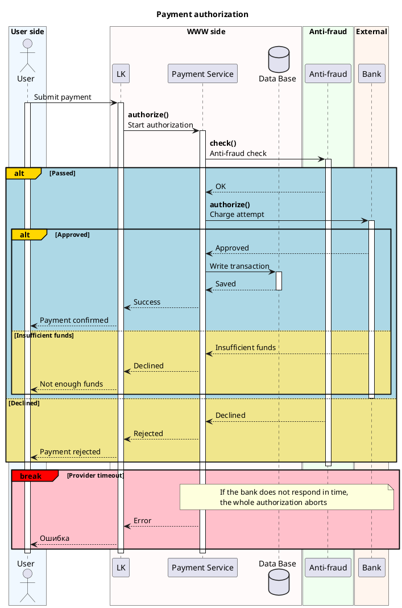

# PlantUML Sequence Diagram — full reference

Read this when you need syntax beyond the SKILL.md workflow: the color palette,
every arrow and block type, notes, dividers, advanced features, and a full
worked prose→diagram conversion.

## Contents
1. Recommended header
2. Participants and stereotypes
3. Boxes (domain grouping) and the color palette
4. Arrows
5. Activation
6. Control blocks and their semantic colors
7. Notes
8. Dividers, spacers, references
9. Variables and reuse
10. Advanced (teoz, autonumber, parallel, hide footbox)
11. Worked example: prose → diagram
12. Common mistakes

---

## 1. Recommended header

```plantuml
@startuml
skinparam MaxMessageSize 300
skinparam responseMessageBelowArrow true
skinparam sequenceMessageAlign center
title <Name>\n<optional subtitle>
```



- `MaxMessageSize 300` — wraps long labels instead of stretching the diagram wide.
- `responseMessageBelowArrow true` — puts return text under the arrow; much cleaner
  when you have many `-->` responses.
- `sequenceMessageAlign center` — centers labels on arrows. Optional, tasteful.
- Add `!pragma teoz true` (see §10) only if you need nested boxes or `&` messages.

Keep the skinparam set small. These four cover 95% of cases; don't pile on more
unless the user asks for specific styling.

---

## 2. Participants and stereotypes

Declare everything up front so ordering is explicit and predictable.

| Keyword       | Use for                                    |
|---------------|--------------------------------------------|
| `actor`       | human / external caller                    |
| `participant` | service, app, component (default choice)   |
| `database`    | datastore                                  |
| `queue`       | message broker / topic (RabbitMQ, Kafka)   |
| `collections` | a set of things                            |
| `boundary`    | DDD boundary object                        |
| `control`     | DDD controller/orchestrator                |
| `entity`      | DDD entity                                 |

Always alias: `participant "Payment Service" as pay`. Then use `pay` everywhere.
Left-to-right declaration order = left-to-right position, so declare in flow order
with the initiator first.

---

## 3. Boxes and the color palette

Group participants by the system they belong to. Each system = one `box` with one
light background color.

```plantuml
box "WWW side" #Snow
participant "LK" as lk
database "Data Base" as db
end box
```

Use **pastel** PlantUML named colors — soft, not eye-searing, and light enough
that PlantUML's black label text stays readable. The recommended set below is
curated to be gentle *and* distinguishable from each other; a rendered swatch
sheet is bundled at `references/palette.png`.

**Tier 1 — recommended (soft and distinct; safe defaults):**

| Role suggestion              | Colors (name · hex)                                            |
|------------------------------|---------------------------------------------------------------|
| Client / gateway / network   | `AliceBlue`·#F0F8FF `PaleTurquoise`·#AFEEEE `LightSteelBlue`·#B0C4DE `Lavender`·#E6E6FA |
| Your own services            | `Linen`·#FAF0E6 `AntiqueWhite`·#FAEBD7 `Cornsilk`·#FFF8DC `LemonChiffon`·#FFFACD `Bisque`·#FFE4C4 |
| External / third party       | `Honeydew`·#F0FFF0 `MintCream`·#F5FFFA `DarkSeaGreen`·#8FBC8F  |
| Special / other domains      | `MistyRose`·#FFE4E1 `LavenderBlush`·#FFF0F5 `Thistle`·#D8BFD8 |
| Infra / shared / neutral     | `WhiteSmoke`·#F5F5F5 `Gainsboro`·#DCDCDC                       |

**Tier 2 — extra near-whites** if you need more subtle variants (very light, so
neighbors made only of these can blur together): `Azure` `Snow` `FloralWhite`
`Ivory` `SeaShell` `OldLace` `GhostWhite` `BlanchedAlmond` `PapayaWhip`.

**Tier 3 — stronger accents**, still pastel but more saturated — use at most one
per diagram, for a box you want to stand out: `PowderBlue` `LightBlue` `Wheat`
`PeachPuff` `PaleGreen` `LightGreen` `LightPink` `Pink` `Plum`.

Rules of thumb that keep diagrams readable:
- Pick neighboring boxes from **different hue families** (a blue next to a cream
  next to a green) so adjacent systems are easy to tell apart.
- **Reuse the same color** for the same system every time it appears, across
  diagrams too — that consistency is what lets a reader learn your visual map.
- `DarkSeaGreen` is the most saturated of Tier 1; it's great as the single
  "external system" color but don't stack several deep colors side by side.
- Avoid vivid/full-saturation names (`Red`, `Blue`, `Green`, `Yellow`, `Orange`,
  `Cyan`, `Magenta`) for boxes — reserve strong color for the *block* semantics
  (§6), where red genuinely means "error".

---

## 4. Arrows

| Syntax   | Meaning                                  |
|----------|------------------------------------------|
| `->`     | request / synchronous call (solid)       |
| `-->`    | response / return (dashed)               |
| `->>`    | async message (open arrowhead)           |
| `-\`     | lost/incomplete (rare)                    |
| `x->`    | message that fails to arrive              |

- Self-message (internal processing): `lk -> lk: text`
- Create a participant on first message: `lk -> api **: create` (rarely needed)
- Message label convention: `**<endpoint / ref>**\n<human description>`. Bold the
  grep-able identifier; plain-text the meaning. Use `\n` for line breaks in labels.

---

## 5. Activation

```plantuml
lk -> api: request
activate api
api --> lk: response
deactivate api
```

- `activate X` / `deactivate X` — explicit, clearest for generated diagrams.
- Shorthand exists (`lk -> api ++ : req`, `api --> lk -- : resp`) but explicit
  activate/deactivate is easier to keep balanced and to read in source.
- Every `activate` needs a matching `deactivate`. Nest them properly: the last
  activated is the first deactivated (stack discipline).
- Stacked activations on the same lifeline (a re-entrant call) are fine and show
  as nested bars — just balance them.
- **When you branch on a response** (`activate` the callee, then an `alt` on what
  it returned): keep that activation open across the whole `alt` and `deactivate`
  once *after* `end`, not inside the branches. See §6 — this is the single most
  common source of a "floating" activation stub.

---

## 6. Control blocks and semantic colors

Syntax: `<block>#<border/label color> #<background color> <label>`. The second
color (background tint) is optional but makes the block scannable.

| Block      | Meaning                          | Standard color                 |
|------------|----------------------------------|--------------------------------|
| `alt`/`else` | mutually exclusive outcomes    | `alt#Gold #LightBlue` / `else #Khaki` |
| `opt`      | happens only sometimes           | `opt#Gold`                     |
| `loop`     | repetition / retry               | `loop` (neutral) or `loop#Gold`|
| `par`      | parallel execution               | `par#Gold`                     |
| `break`    | **aborts** the flow (error)      | `break#Red #Pink`              |
| `critical` | critical section                 | `critical#Gold`                |
| `group`    | plain labeled grouping           | `group`                        |

All of these close with `end`. (Only `box` closes with `end box`.)

**Semantic rule:** blue-tinted = the normal/primary branch, khaki = alternative
branches, **red/pink = anything that errors or aborts**. This is the single most
important readability convention — a reader finds every failure path by its red
border. Keep it consistent.

`break` vs `opt`: use `break` when hitting this path *stops* the surrounding flow
(propagate an error and bail). Use `opt` for a step that may or may not run but
the flow continues either way.

### Branching on a response (important)

Two rules turn a messy branch into a clean one:

1. **Success/expected branch first.** Open the `alt` with the 200/happy case;
   put errors and alternatives in the `else` branches below. Readers scan
   top-down, so the normal outcome should set the baseline.

2. **Activate on the request, deactivate once after `end`.** The callee was
   `activate`d on the request line before the `alt`; that activation covers the
   whole "here are the possible outcomes" block, so let its bar run continuously
   and close it a single time *after* `end`. Deactivating inside each branch
   chops the bar at the branch boundary and PlantUML draws a stray floating
   activation — the "response arrow hanging in the air." Extra calls made
   *inside* a branch still get their own local `activate`/`deactivate`.

```plantuml
' ✗ wrong — error case first, callee closed inside each branch
rc -> api: find
activate api
alt 404 not found
  api --> rc: 404
  deactivate api
else 200 exists
  api --> rc: 200 OK
  ' floating stub — the response arrow "hangs in the air"
  deactivate api
end

' ✓ right — success first, one continuous bar closed after end
rc -> api: find
activate api
alt 200 exists
  api --> rc: 200 OK
else 404 not found
  api --> rc: 404
  ' an extra call gets its own activate/deactivate
  rc -> api: create
  activate api
  api --> rc: 201
  deactivate api
end
deactivate api
```

Example with nesting:

```plantuml
alt#Gold #LightBlue success
  api --> lk: 200 OK
else #Khaki not found
  opt#Gold create it
    lk -> api: create
    break#Red #Pink Error
      api --> lk: Error
    end
  end
end
```

---

## 7. Notes

```plantuml
note right of lk: single-line note
note over lk, api: note spanning two lifelines
note left
multi-line
note
end note
```

- `hnote` (hexagon) and `rnote` (rectangle) for shaped variants.
- Use notes to explain *why* — error-propagation logic, business rules, a
  documented assumption. Don't narrate what the arrow already says.

---

## 8. Dividers, spacers, references

- `== Phase name ==` — a labeled horizontal divider; split long flows into phases.
- `...` — elapsed time; `...5 minutes later...` for a labeled gap.
- `|||` — extra vertical spacing.
- `ref over lk, api: Reused sub-flow` — reference a flow documented elsewhere
  instead of redrawing it.

---

## 9. Variables and reuse

```plantuml
!$account = "/account"
!$create  = "/account/create"
lk -> api: **Request**\n$account
```

Pull any endpoint/ref used more than once into a `!$` variable at the top:
consistent rendering, single point of change.

---

## 10. Advanced

- `!pragma teoz true` — required for **nested boxes** (a box inside a box) and for
  same-time messages joined with `&`:
  ```plantuml
  lk -> api: a
  & lk -> db: b   ' a and b at the same height
  ```
- `autonumber` — number messages (`autonumber`, `autonumber 10 10`,
  `autonumber "<b>[000]"`). Useful for step-referencing in docs.
- `hide footbox` — removes the duplicated participant boxes at the bottom; cleaner
  for short diagrams.
- `skinparam sequence { ... }` — fine-grained styling if the user asks.

---

## 11. Worked example: prose → diagram

**Prose input:**
> A user submits a payment on the site. The site (LK) asks the Payment Service to
> authorize it. Payment Service first checks the anti-fraud service. If anti-fraud
> declines, the user gets a rejection. Otherwise Payment Service calls the external
> bank. If the bank approves, we write the transaction to the DB and confirm to the
> user. If the bank says insufficient funds, we tell the user. If the bank times
> out, the whole thing aborts with an error.

**Diagram:**



Every domain is a colored box; the success path is blue; the alternatives are
khaki; the timeout abort is a red `break` with a note explaining the propagation.

---

## 12. Common mistakes

- **Unbalanced blocks** — every `alt/opt/loop/par/break/critical/group` needs an
  `end`; every `box` needs `end box`. The linter catches these.
- **Unbalanced activation** — orphan `activate` or `deactivate`. The linter warns.
- **Deactivating a request's callee inside `alt` branches** — if you `activate`d
  it before the `alt`, close it once after `end`, not in each branch, or you get
  a floating activation stub. Also lead with the success branch. The linter warns
  on both. (§6)
- **Solid arrow for a response** — returns must be dashed `-->`.
- **Color as decoration** — don't color blocks arbitrarily; blue=normal,
  khaki=alternative, red=error. Consistency is the whole point.
- **Everything in one `alt`** — use `opt` for optional steps and `break` for
  aborts; reserve `alt/else` for genuine either/or.
- **Over-long labels** — move detail into a `note`; keep the arrow label to the
  endpoint + a short phrase.
- **Trailing inline comments** — PlantUML only accepts `'` comments at the start
  of a line (or `/' … '/` blocks). `deactivate api ' note` is a parse error. Put
  the comment on its own line above the statement.
- **Forgetting the source language** — labels match the input language; only
  PlantUML keywords are English.
